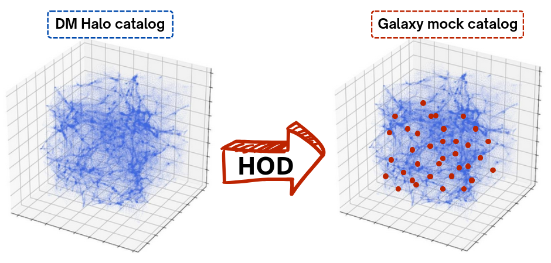

# HODDIES

**HODDIES** is a Python toolkit to generate mock galaxy catalogs based on Halo Occupation Distribution (HOD) model. It also provides tools to fit HOD models on data. 




## Documentation

Documentation is hosted on Read the Docs, [HODDIES docs](https://hoddies.readthedocs.io).

### Examples

An example can using a custom halo catlog. The code is initialized using the default [paramerter file](https://github.com/antoine-rocher/HODDIES/blob/main/HODDIES/default_HOD_parameters.yaml)
(pseudo-code, for an example with all variables defined see [this notebook](https://github.com/antoine-rocher/HODDIES/blob/main/nb/basic_HOD_examples.ipynb)):
```
from HODDIES import HOD
# Initiate the HOD instance with default parameter file parameters_HODdefaults.yaml
# Using path to catalog

path_to_halo_catalog = '/path/to/halo_catalog' # catalog type can be fits, h5, asdf
HOD_obj= HOD(hcat_file='path_to_halo_catalog')

# Using a preloaded catalog. 
# This catalog need to be a dictonary / structured array or mpy Catalog.
# Colunms names should be at least:
# ['x', 'y', 'z', 'vx', 'vy', 'vz','Mh', 'Rh', 'Rs', 'c', 'Vrms', 'halo_id']  

HOD_obj= HOD(hcat_file=mycatalog) 

# Using root AbacusSummit simulation path, example at NERSC

HOD_obj= HOD(path_to_abacus_sim='/global/cfs/cdirs/desi/cosmosim/Abacus')

# Generate the mock catalog

mock_cat = HOD_obj.make_mock_cat(fix_seed=None) 

# Compute clustering statistics

rp, wp = HOD_obj.get_wp(cats, tracers='ELG')
s, xi = HOD_obj.get_2PCF(cats, tracers='ELG')
```

One can also plot the HOD distribution and the Halo mass function (HMF) of the output mock catalog:
```
#Plot HOD

HOD_obj.HOD_plot()

#Plot Halo mass function 

HOD_obj.plot_HMF(mock_cat, show_sat=True)

```

Example notebooks are provided in directory [nb/](https://github.com/antoine-rocher/HODDIES/tree/main/nb).


### Saved mock-data fits

From the repository root in the cosmodesi environment, use
`HODDIES/fit_functions/scripts/run_mock_minimizer.py` to fit the bundled test
measurements. The original `run_minimizer_test.py` remains available.

```bash
# Validate data and covariance without loading halos.
python HODDIES/fit_functions/scripts/run_mock_minimizer.py --tracers LRG --statistics wp xi_ells --check-data
# Fit selected statistics; xi_ells expands to xi0 and xi2.
python HODDIES/fit_functions/scripts/run_mock_minimizer.py --tracers LRG --statistics wp xi2
# Refresh the report, including any additional output directory.
python HODDIES/fit_functions/scripts/summarize_mock_fits.py --root /path/to/fits
```

Statistics are `wp`, `xi_ells`, `xi0`, `xi2`, and `delta_sigma`; tracers are
`LRG`, `ELG`, or both. Each fit automatically updates
[MOCK_FIT_RESULTS.md](MOCK_FIT_RESULTS.md) with parameters, chi-square,
optimizer diagnostics, and comparison plots. Results default to separate run
directories under `tmp/mock_fits/`. MPI is enabled with `--mpi` when launched
through `srun` or `mpiexec`.

The default covariance filename follows the selected statistic families and
tracers: `wp` uses `Mcov_small_box_z0.5_wp_<tracers>.txt`, `wp xi_ells` uses
`Mcov_small_box_z0.5_wp+xi_<tracers>.txt`, and adding `delta_sigma` uses
`Mcov_small_box_z0.5_wp+xi+delta_sigma_<tracers>.txt`. Families appear in
`wp`, `xi`, `delta_sigma` order. Individual `xi0`/`xi2` selections use the `xi`
matrix and select the matching multipole blocks. A missing matching file must
be supplied; the runner does not silently use a matrix with extra families.
Use `--covariance-file` to override the filename. For a different source layout,
also set `--covariance-tracers` and `--covariance-statistics`; the runner selects
and reorders the matching rows and columns. `--help` lists all options.

### DESI Y1 LRG clustering and lensing

The DESI runner can add the supplied LRG1 HSC lensing measurements:

```bash
python HODDIES/fit_functions/scripts/run_desi_y1_minimizer.py --tracers LRG --with-delta-sigma --check-data
sbatch HODDIES/fit_functions/scripts/run_desi_y1_minimizer_debug.sh --tracers LRG --with-delta-sigma
```

`--with-delta-sigma` uses z=0.5 halos and LRG clustering at `0.4 < z < 0.6`.
It reads `rp`, `ds_obs_lrg1`, and `ds_err_lrg1` from
`../tmp/bgs2_bgs3_lrg1_lrg2_best_fit_hsc.csv`; override this with
`--delta-sigma-file`. The final missing CSV measurement is excluded. Radial
edges are fixed to `np.logspace(-1, 1.6, 13)`, in Mpc/h. The estimator evaluates
its internal fine-grid model at the CSV's 13 valid `rp` centres so the model
and measurements remain aligned. DeltaSigma
values and errors retain the CSV units, h Msun/pc², matching the model output.

The lensing covariance uses the squared CSV errors on its diagonal; the
clustering-lensing cross covariance is assumed zero. The finite-mock correction
applies only to the clustering precision. Field particles load only for lensing
fits. Saved inputs and the DESI results report include the lensing bins,
covariance assumptions, parameters, and plots. Lensing is restricted to this
LRG bin; the default clustering-only fit remains at z=0.95.

## Requirements

Strict requirements are:

  - numpy
  - scipy
  - yaml
  - [numba](https://numba.pydata.org/)
  - [mpytools](https://github.com/cosmodesi/mpytools)
  

Extra requirements are:

  - [pycorr](https://py2pcf.readthedocs.io/en/stable/) for 2PCF computation
  - [cosmoprimo](https://cosmoprimo.readthedocs.io/en/latest/) for cosmology tools
  - [abacusutils](https://abacusutils.readthedocs.io/en/latest/installation.html) to load AbacusSummit simulations
  - [idaes-pse](https://idaes-pse.readthedocs.io/en/stable/tutorials/getting_started/index.html) for inital sampling when performing HOD fits  
  - [scikit-learn](https://scikit-learn.org/stable/) used for gaussian processes regression when performing HOD fits  

## Installation

### pip

Simply run:
```
python -m pip install git+https://github.com/antoine-rocher/HODDIES#egg=HODDIES[all]
```

### git

First:
```
git clone https://github.com/antoine-rocher/HODDIES.git
```
To install the code:
```
python setup.py install --user
```

## License

**HODDIES** is free software distributed under a BSD3 license. For details see the [LICENSE](https://github.com/antoine-rocher/HODDIES/blob/main/LICENSE).

## Credits

Arnaud de Mattia for useful tools from [cosmodesi](https://github.com/cosmodesi)
 